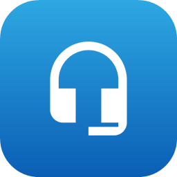

# RoomLink — two-way audio bridge for Windows



Turns a Bluetooth headset worn by a *remote* person into a hands-free intercom:

```
headset microphone  →  PC speakers   (you hear them)
PC microphone       →  headset speaker   (they hear you)
```

The remote person runs nothing — the headset just behaves like a phone call.
Great for talking to someone in another room while they keep their headset on.

---

## Requirements

| | |
|---|---|
| OS | Windows 10 / 11 (64-bit) |
| Runtime | **None needed** — the app is self-contained (no .NET install required) |
| Hardware | A Bluetooth (or wired) headset with microphone + a mic and speakers on this PC |

---

## Install

### Option A — Installer (recommended)

1. Download the latest `RoomLinkSetup-<version>.exe` from the
   [Releases](https://github.com/eaeoz/RoomLink/releases) page.
2. Run it. By default it installs per-user to
   `%LOCALAPPDATA%\Programs\RoomLink` (no admin rights needed).
3. In the wizard you can optionally tick:
   - **Create a desktop icon**
   - **Start RoomLink when Windows starts**

The setup exe, the installed app, the Start-menu and desktop shortcuts all
carry the same headset icon.

### Option B — Portable (no install)

1. Download `RoomLink-Portable.zip` from Releases.
2. Unzip anywhere and run `RoomLink.exe`.
3. To auto-start with Windows, create a shortcut to it in
   `shell:startup` (optional).

### Uninstall

Use *Apps → Installed apps* in Windows Settings, or the
**Uninstall RoomLink** entry in the Start-menu folder. Your settings
(`%APPDATA%\RoomLink`) are left untouched.

---

## Run & use

1. Start **RoomLink** (Start menu, desktop icon, or `RoomLink.exe`).
2. The control window opens. Pick four devices:
   - **Remote person** group: their headset *microphone* and headset *speaker*
     (the Bluetooth hands-free endpoints of the headset plugged into *this PC*).
   - **This PC** group: your *microphone* and your *speakers*.
3. Adjust the two volume sliders (100% is unity; up to 300% boosts).
4. Click **Start bridge**. The tray icon turns green and the status line shows
   live levels and buffer latency. Click **Stop bridge** to stop.
5. **Close the window when you're done** — that quits RoomLink completely
   (bridge stopped, nothing left running in the background). While the window
   is open you'll also find a tray icon with a right-click menu:
   Open, Start/Stop bridge, auto-start toggle, log file, GitHub, Exit.

Selections and gains are saved automatically to `%APPDATA%\RoomLink\settings.json`
and restored on the next launch.

### Command-line flags (diagnostics)

| Command | What it does |
|---|---|
| `RoomLink.exe --devices` | Writes all mic/speaker endpoints to `RoomLinkDevices.txt` |
| `RoomLink.exe --cli` | Interactive console harness for development/testing |

---

## Build from source

### Prerequisites

- [.NET 8 SDK](https://dotnet.microsoft.com/download/dotnet/8.0)
  (`winget install Microsoft.DotNet.SDK.8`)
- [Inno Setup 6](https://jrsoftware.org/isinfo.php) — optional, only for the
  installer (`winget install JRSoftware.InnoSetup`)

### One-step build

```powershell
.\build.ps1
```

This regenerates the app icon, publishes, and produces everything in `dist\`:

| Artifact | Description |
|---|---|
| `dist\publish\RoomLink.exe` | Single-file, self-contained app (works portable) |
| `dist\RoomLink-Portable.zip` | Zipped exe for the portable release |
| `dist\RoomLinkSetup-<version>.exe` | Installer (built only if Inno Setup 6 is installed) |

### Manual steps

```powershell
# Regenerate the multi-size icon from Tools\IconSrc
powershell -NoProfile -ExecutionPolicy Bypass -File Tools\MakeIcon.ps1

# Publish the app (single-file, self-contained, win-x64)
dotnet publish src\RoomLink\RoomLink.csproj -c Release -r win-x64 -o dist\publish

# Build the installer
& "$env:LOCALAPPDATA\Programs\Inno Setup 6\ISCC.exe" installer\roomlink.iss
```

### Run from source (dev)

```powershell
dotnet run --project src/RoomLink
```

---

## Project structure

```
RoomLink/
├── build.ps1                     # One-step release build (icon + publish + installer)
├── README.md
├── RoomLinkDevices.txt           # Output of `RoomLink.exe --devices`
├── installer/
│   └── roomlink.iss              # Inno Setup 6 script → RoomLinkSetup-<version>.exe
├── src/
│   └── RoomLink/
│       ├── RoomLink.csproj       # net8.0-windows, WinForms, NAudio, single-file publish
│       ├── Program.cs            # Entry point; --cli / --devices flags, then GUI
│       ├── TrayContext.cs        # App shell: bridges, tray icon + menu, app lifetime
│       ├── DevicePickerForm.cs   # Main window: device dropdowns, gain sliders, status
│       ├── DeviceService.cs      # WASAPI endpoint enumeration (BT / virtual / default flags)
│       ├── Bridge.cs             # One audio direction: mic → ring buffer → speaker
│       ├── Settings.cs           # Persisted config: %APPDATA%\RoomLink\settings.json
│       ├── Logger.cs             # File logger: %APPDATA%\RoomLink\RoomLink.log
│       ├── IconFactory.cs        # Runtime-drawn tray icon (green = bridging, gray = idle)
│       ├── ConsoleHarness.cs     # Development console (--cli)
│       └── Assets/
│           ├── appicon.ico       # Multi-size app icon (exe, shortcuts, installer)
│           └── appicon-256.png   # 256px master used to build the .ico
├── Tools/
│   ├── MakeIcon.ps1              # Composites the glyph and builds appicon.ico
│   └── IconSrc/
│       └── headset_mic_512.png   # Downloaded source glyph (see license below)
└── dist/                         # Build output (publish, zip, setup)
```

### How it fits together

- `Program.cs` starts `TrayContext`, which owns the two `Bridge` objects
  (one per direction), the tray icon, and the `DevicePickerForm` window.
- Each `Bridge` captures from a microphone with `WaveInEvent`, feeds a ring
  buffer, and plays into a speaker with `WaveOutEvent` — so capture and
  playback run on independent WASAPI clocks with ~40 ms buffers.
- `Settings` and `Logger` both live under `%APPDATA%\RoomLink`.

---

## Troubleshooting

- **No sound from the remote person** — make sure their headset mic is the
  Bluetooth *hands-free* (HFP) endpoint, not the stereo (A2DP) one; A2DP has
  no microphone. The profile switch happens when the bridge starts and can
  take ~1 second.
- **Echo / feedback** — without echo cancellation the headset mic picks up
  your speakers. Keep your speaker volume low, or have the remote person use
  the headset speaker.
- **Device list is stale** — click **Refresh devices** after connecting a
  new Bluetooth headset.
- **Something misbehaves** — open the log via the tray menu or check
  `%APPDATA%\RoomLink\RoomLink.log`.

---

## Icon license

The app icon is based on the Material Design icon *headset mic* by
[Google](https://github.com/google/material-design-icons), licensed under
[CC BY 4.0](https://creativecommons.org/licenses/by/4.0/), with the background,
gradient, and colors added for RoomLink.
